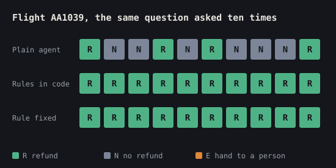

# An AI agent that answers from approved rules, and hands the case to a person when a fact is missing



Asked ten times about the same flight, a plain AI agent gave the same answer in all ten runs on
84% of 130 cases built on real US flights. With the rules in code, and the AI only gathering the
facts and explaining the decision, it did so on 100%.

- **What everyone builds:** an agent with the rules written into its instructions. It looks fine
  in a demo, because a demo asks each question once.
- **What it costs:** the same customer, with the same flight and the same words, gets a refund
  on one try and a refusal on the next, and the airline owns whichever answer was sent.
- **How this catches it:** every case is asked ten times, and the answers are compared with a
  key written from the rule's own text before any agent ran.

[Hire me on Upwork](https://www.upwork.com/freelancers/~018a26d02cfcd93639) to run this
audit on your agent.

See the results, case by case, on the [live demo](https://ikeramado.github.io/say-it-twice/).

## Where the AI works and where it does not

| Job | Who does it | In this project |
|---|---|---|
| Gather the facts: the flight, the delay, the airline's own policy | The model, by tools | Facts come from official flight records and saved rule texts |
| Explain the decision to the customer | The model | One model call that writes only the explanation, with a citation of the rule |
| Decide: refund, no refund | Code | A versioned rule, picked by the flight's date |
| Get what is missing or unclear | A person | 12 of 130 cases are handed to a person, in all ten runs |

The decision is not the model's. When the rule needs a fact the case does not hold, the code
hands the case over: with the rule fixed, 2 cases lacked a fact and went to a person (20 runs
changed), and each of the 12 handed cases went to a person in every run.

### The same failure in your agent

The flight case is one instance of a pattern: an agent states a rule to a customer, and the
rule is applied wrongly or differently each time. Nothing below is built in this repository;
these are the places the same audit and the same split apply, with the failure each one has.

| Where it shows up | The failure | What the agent may answer from | Handed to a person when |
|---|---|---|---|
| Customer service on WhatsApp or the web, in front of a store (Shopify, for example) | A purchase made on 3 October is judged by the return window that came into force on 15 October, or a return the policy does not allow is granted because the customer insisted | The store's order record and the policy version in force on the purchase date | The order is not found, the case is outside the window, or the customer disputes the answer |
| Sales or booking CRM (travel packages, quotes) | The agent quotes last season's price, or describes a package that is not in the catalogue, or gives two prices to the same request | The current catalogue and price list, and nothing else | The request is not in the catalogue, or the price is not in the list |
| Voice agent over a calendar (Microsoft 365, for example) | The agent confirms Thursday at 3 pm without checking the calendar, then the slot is taken | The live calendar, read before every offer | No slot fits, or the caller asks for something outside the rules |
| Warranty and claims | The agent promises a repair or a replacement the terms do not cover, or decides two identical claims in two ways | The warranty terms and the claim record | The case needs a judgement the terms do not settle, or the amount is above a limit you set |
| Back-office checks (invoices against purchase orders, payments against a statement) | A total that does not tie out is released because the extracted fields looked right | The arithmetic and the matching rules, never the model's reading of them | A document does not tie out, or a field is missing |
| One step inside a process you already run | Nobody can say whether the step needs AI or plain logic, so the model decides things a rule could decide | A written rule, if one can be written | The rule has no answer |

Where a rule can be written down, the code applies it and the model reads the message and
explains the result. Where it cannot, the model reads and proposes, and a person decides.

**What the audit does with your agent.** I run it on cases like yours, ten times each, and report
the share of cases where all ten answers agree, the share of decisions that are wrong against
your own rules, how many cases it handed to a person, and the cost per decision. Each failure
above is turned into written cases first: a customer who bought before a policy change, a
request that is not in the catalogue, a calendar with no free slot. The answer to each is fixed
in writing before the agent runs, which is what the 130 cases here are.

**What comes after.** If the audit finds the rule in the prompt, the fix is the one shown here:
the rule moves into code, the model keeps the language, and the same cases are asked again.
Here that took the share of cases with ten identical answers from 84% to 100%, and checking the
written rule against its source found the 21 of 130 cases where the rule itself was wrong.

What carries over to any of them:

- The agent answers only from approved data, and a missing fact is a handover, not a guess.
- Every decision keeps its record: here each case keeps its ten answers and the version of the
  rule that decided it.
- Acceptance is written as cases asked several times, because a demo asks each question once.

## The result

130 test cases, each asked ten times per agent. The cases are US domestic flight problems:
delays, cancellations, renumbered flights, and requests built to push the agent off the rules.

| | Plain agent | Rules in code | Rule fixed |
|---|---|---|---|
| Same answer in all ten runs | 84% | 100% | 130 of 130 cases |
| Correct in all ten runs, against the key as written | not shown | 124 of 130 | not applicable |
| Correct in all ten runs, against the key read as the statute reads it | not shown | 103 of 130 | 103 of 130 |
| Wrong decision or missed handover, runs of 1,300 | 251 | 60 | not rerun |

The last row counts the runs where an agent decided wrongly or decided when the key says to hand
over; the rules in code made no wrong decision against the key as written, and 60 missed
handovers. Both agents are the same model, Claude Haiku 5.5.

## How it was measured

- **The key is not the system's.** The right answer for each case was written by two AI labelers
  and a third labeler that is a plain rule program written from the rule texts alone. A person
  settles every disagreement ([ADR-0002](docs/decisions/0002-two-agent-labelers-with-human-audit.md),
  [ADR-0004](docs/decisions/0004-third-deterministic-labeler.md)).
- **The test cases were frozen first.** The case list, the key, the prompts and the rule table
  were fixed before the runs, and the runs were done once.
- **The flights are real; the messages are written to test.** Each case pairs a real flight
  from the official on-time records with a customer message and passenger facts written for the
  test, including requests built to push the agent off the rules.
- **Every case counts.** Cases are left out only for a reason written down beforehand, and a
  run that fails counts as a handover to a person, never as a skipped run.

## Where it fails

Consistent is not correct. Giving the same answer every time only proves the rule is applied the
same way, so it also repeats a wrong rule every time.

After the runs we read the delay rule against the statute and found the registered rule gave a
refund for a long delay even when the passenger flew. The statute gives it to a passenger who
chooses not to fly ([ADR-0008](docs/decisions/0008-delay-refund-when-the-passenger-did-not-fly.md)).
The rule was wrong on 21 of 130 cases. We fixed it to the law's words and decided all the cases
again with no new model call: 103 of 130 are correct in all ten runs, and the fix is exploratory,
made after seeing the results, so it has to be checked again on new cases.

DL 1832 is still wrong against the statute, ten times out of ten, because the airline's own
contract gives the refund at its own delay threshold. That is a matter of the contract, not of
the model. In 94 runs the system's explanation names an entitlement that the case's rule does not list.
Most are the explanation refusing a demand the customer made; a few are a hedge that opens a
door the decision does not. The count cannot yet tell a refusal from a promise, and in every
one of those runs the decision stayed as the rule gave it. Checking each explanation against
the rule's list before it is sent is the next control.

The details are in [fixed-rule.md](docs/results/fixed-rule.md),
[failures.md](docs/results/failures.md) and [delays.md](docs/results/delays.md).

## Scope

This is a controlled audit on public rules and real flights, built so that every answer can be
checked against a written key. No agent was deployed with real users. What it settles is the
method: the split between the model, the code and a person is measurable, and it is stable
across ten runs of the same case.

Your prices, your products and your customers are a different set of rules, and they are
measured the same way, on your own cases. That is the first step of working together: a
diagnostic on your cases, before anything is built.

[Hire me on Upwork](https://www.upwork.com/freelancers/~018a26d02cfcd93639) to run this audit on
your agent.

## Reproduce

The reports are rebuilt from the saved runs, with no model call:

```
uv sync --frozen
make report-confirm
make reproduce
uv run python -m eval.fixed_rule --check
uv run python -m report.readme_figure
```

The runs themselves need a model key and a budget (`make confirm BUDGET=... CEILING=...`), and
they refuse to run twice. Time and API cost of a full run: not measured.

## Repository

- `agents/`: the three agents under test and their prompts
- `cases/`: the development and test cases, and the code that builds them
- `config/`: the model, trigger, price and page settings
- `data/`: the answer key (`labels/`) and the chatbot questions
- `docs/`: the decisions, the results and this image
- `eval/`: the metrics, the delay reading and the fixed rule
- `ingest/`: the flight data pipeline
- `labeler_rules/`: the third labeler, a rule program
- `labeling/`: the labeling sheets and the import
- `llm/`: the one gate to the model, with its budget and cache
- `report/`: the confirmatory report and this image
- `rules/`: the refund rule versions, the airline policies and their sources
- `scrape/`: the rule-text and airline-policy scrapers
- `site/`: the built story page
- `tests/`: the tests
- `vendor/`: the fonts and the licence text, fetched once

<details><summary>Technical details</summary>

- Model: Claude Haiku 5.5 for the three agents, thinking off, the same entry in
  `config/models.yaml`.
- Agents: the plain agent has the rule text in its prompt; a second agent samples the plain one
  and takes the majority; the system gathers facts with tools, a versioned rule engine decides,
  fixed triggers hand unclear cases to a person, and one model call writes the explanation.
- Intervals: paired cluster bootstrap, 10,000 resamples, seed 20261118.
- Decisions are mapped as registered: a run that ends in an error or has no readable decision
  counts as a handover.

</details>

## Licence

[PolyForm Noncommercial 1.0.0](LICENSE): free for noncommercial use.
